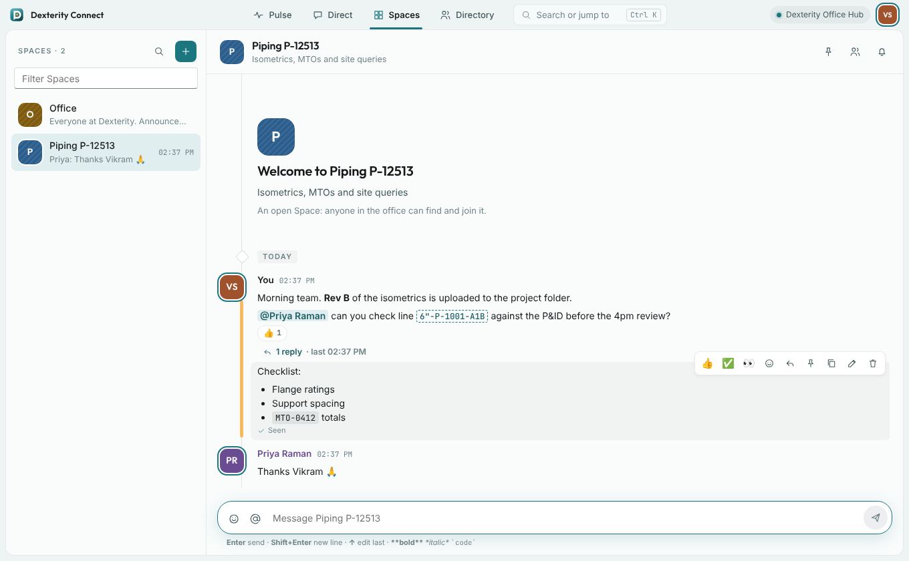

  

  
  
  

<h3 align="center"><a href="https://dexterity-admin.github.io/dexterity-connect/">Open the interactive tour →</a></h3>

**Dexterity Connect** is the workplace messenger of Dexterity Design Services. It provides Spaces, Direct conversations, side-tracks, files and calls, and everything stays on the office network.

## Download

The newest builds are on the **[Releases page](https://github.com/dexterity-admin/dexterity-connect/releases)**. Pick the file for your device:

| You have | Download | Notes |
| --- | --- | --- |
| Windows 10 / 11 PC | `DexterityConnect-Setup-<version>.exe` | Installs per user. If SmartScreen warns, choose *More info → Run anyway*. |
| Mac with Apple silicon | `DexterityConnect-<version>-mac-arm64.dmg` | Right-click → Open the first time. |
| Intel Mac | `DexterityConnect-<version>-mac-x64.dmg` | |
| Android phone | `DexterityConnect-<version>.apk` | Allow installs from your browser when asked. Works on the office Wi-Fi. |
| The office hub PC | `DexterityConnectHub-<version>-win-x64.zip` | Unzip, then double-click `Install-Hub.cmd`. |

Every release includes `SHA256SUMS.txt`. Installed apps update themselves: they check when they open, every few hours and on demand. They download from the office hub's mirror when they can, so PCs without internet still update.

**Channels:** releases marked *Pre-release* are **beta** builds. Installed apps receive them only if *Preferences → Updates → Beta* is chosen. Everyone else gets **stable** releases.

## A look inside

  
  

- **Spaces and Direct:** open and private Spaces for teams and projects, plus one-to-one and group conversations.
- **Spine timeline:** messages hang off a single spine in runs, and your own runs carry an amber notch.
- **Side-tracks:** reply threads that stay attached to the message they answer.
- **Mentions, reactions, pins, edits and "Seen" receipts.** Line numbers such as `6"-P-1001-A1B` are recognised automatically.
- **Pulse:** only what needs you. **Ctrl+K** jumps to anyone and anything.
- **Secure by design:**
  - Each device has its own key, and admins approve each new one.
  - Connections are TLS, pinned to the hub's certificate.
  - Every approval and removal is recorded in an audit trail.

## Setting up an office

1. On one always-on PC, unzip the hub (for example to `D:\Dexterity Connect Hub`) and run `Install-Hub.cmd`.
2. Install the app on your PC and click **Request access**. You become the owner.
3. Approve colleagues in the **Control room** as they install, matching the device code shown on their screen.

---

© 2026 Dexterity Design Services Pvt. Ltd. Internal software. This repository hosts releases and the product page only.
