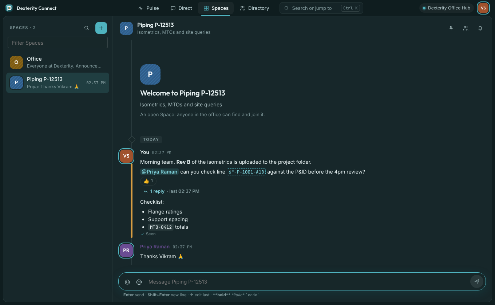

  

  
  
  

<h3 align="center"><a href="https://dexterity-admin.github.io/dexterity-connect/">Open the interactive tour →</a></h3>

**Dexterity Connect** is the workplace messenger of Dexterity Design Services. It provides Spaces, Direct conversations, side-tracks, files and calls, and everything stays on the office network.

## Download

The newest builds are on the **[Releases page](https://github.com/dexterity-admin/dexterity-connect/releases)**. Pick the file for your device:

| You have | Download | Notes |
| --- | --- | --- |
| Windows 10 / 11 PC | `DexterityConnect-Setup-<version>.exe` | Installs per user. If SmartScreen warns, choose *More info → Run anyway*. |
| Mac with Apple silicon | `DexterityConnect-<version>-mac-arm64.dmg` | Right-click → Open the first time. |
| Intel Mac | `DexterityConnect-<version>-mac-x64.dmg` | |
| Android phone | `DexterityConnect-<version>.apk` | Allow installs from your browser when asked. Works on the office Wi-Fi. |
| The office hub PC | `DexterityConnectHub-Setup-<version>.exe` | Run it and click *Yes*. It installs the hub as a Windows service, opens the firewall, keeps the PC awake and checks the hub answers. After that the hub updates itself. (`DexterityConnectHub-<version>-win-x64.zip` is the by-hand fallback.) |

Every release includes `SHA256SUMS.txt`. Installed apps update themselves: they check when they open, every few hours and on demand. They download from the office hub's mirror when they can, so PCs without internet still update. The office hub updates itself too: it installs a new version at 03:00 after a backup, never during a meeting, and goes back to the previous one by itself if the new one does not start.

Fixed-name links always give the newest stable build, for example [`DexterityConnectHub-Setup.exe`](https://github.com/dexterity-admin/dexterity-connect/releases/latest/download/DexterityConnectHub-Setup.exe) and [`DexterityConnect-Setup.exe`](https://github.com/dexterity-admin/dexterity-connect/releases/latest/download/DexterityConnect-Setup.exe).

**Channels:** releases marked *Pre-release* are **beta** builds. Installed apps receive them only if *Preferences → Updates → Beta* is chosen. Everyone else gets **stable** releases.

## A look inside

  
  

- **Spaces and Direct:** open and private Spaces for teams and projects, plus one-to-one and group conversations.
- **Spine timeline:** messages hang off a single spine in runs, and your own runs carry an amber notch.
- **Side-tracks:** reply threads that stay attached to the message they answer.
- **Mentions, reactions, pins, edits and "Seen" receipts.** Line numbers such as `6"-P-1001-A1B` are recognised automatically.
- **Pulse:** only what needs you. **Ctrl+K** jumps to anyone and anything.
- **Secure by design:**
  - Each device has its own key, and admins approve each new one.
  - Connections are TLS, pinned to the hub's certificate.
  - Every approval and removal is recorded in an audit trail.

## Setting up an office

A new hub sets the office up on its first start: the real floor plan with everyone's names on their seats, this
year's holidays from management's circular, Nib's day-sheet times, the notice desks, nightly backups to a second
disk, and a live **Setup check** at the top of the Control room. What is left needs a person:

1. On the PC that stays on, run `DexterityConnectHub-Setup.exe` and click **Yes**.
2. Install the app on your PC and click **Request access**. You become the owner; the **Setup check** shows what is left.
3. For home and mobile data, paste one Cloudflare API token into **Control room → Outside the office → Set up with Cloudflare**.
4. For Zoho Calendar, register the office's Zoho client once in **Control room → Integrations → Zoho Calendar**; each person then connects their own calendar.
5. Approve colleagues as they install, matching the device code shown on their screen.

Click by click: [what you still do by hand (PDF)](https://dexterity-admin.github.io/dexterity-connect/assets/Dexterity-Connect-Office-Setup.pdf).
Every year, drop the new holiday circular PDF into your conversation with Nib and click **Register**.

---

© 2026 Dexterity Design Services Pvt. Ltd. Internal software. This repository hosts releases and the product page only.
